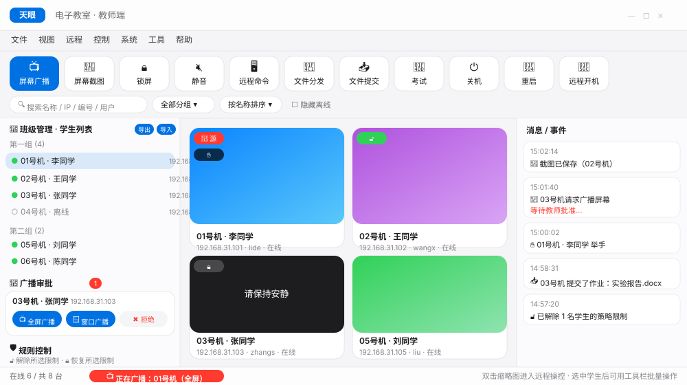
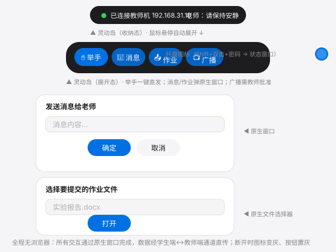

# 天眼 · 电子教室（TianYan）

局域网电子教室/机房管控系统，Go 实现，教师端 + 学生端双程序，GPL-3.0 开源。

- **教师端**：内置 Web 控制台，实时监控学生屏幕、远程操控、一键广播指令、收发文件、导入导出数据。
- **学生端**：开机自动上线、自动上报 IP/MAC、执行远程指令、本地黑白名单管控、内置举手/发消息/交作业小工具栏。

## 界面预览

| 教师端控制台 | 学生端小工具栏 |
| --- | --- |
|  |  |

> 注：若 GitHub 因安全策略未内联渲染 SVG（显示为链接），可直接打开 `docs/preview-teacher.svg`、`docs/preview-student.svg` 查看，或导出为 PNG。

## 当前已实现（MVP）

| 模块 | 说明 |
| --- | --- |
| 自动发现 | 多播（224.0.0.167）自动发现学生机，上报 IP / MAC / 主机名 / 系统 / 分辨率 |
| 实时监控 | 学生机缩略图网格（2 fps）+ 双击全屏投屏（10 fps 原分辨率） |
| 远程操控 | 全屏视图内键鼠转发（移动/点击/滚轮/键盘），可一键开启/关闭控制 |
| 声音管控 | 教师上线学生自动静音、一键静音/取消、远程调节音量（Windows 精确控制） |
| 黑屏/静默 | 一键黑屏并自定义显示文字；一键锁定学生输入 |
| 开关机 | 远程关机/重启/注销；远程开机（Wake-on-LAN） |
| 打开/关闭应用/网页 | 远程打开网页/应用，或按进程名关闭应用、按窗口标题关闭网页 |
| 黑白名单 | 应用进程名黑名单（自动结束）+ 网站域名黑名单（hosts 屏蔽）+ **U 盘运行游戏侦测并强制关闭** |
| 学生小工具栏 | 学生端 `http://127.0.0.1:5600`：举手、发消息、提交作业 |
| 文件收发 | 教师批量发送文件到学生机；学生提交作业上传到教师机 |
| 数据导入导出 | CSV / JSON 导入导出（学生姓名、IP、MAC、分组、编号） |
| 断网管控 | 可选 `-reboot-on-offline`：检测到与教师断开后倒计时重启还原 |
| CI/CD | GitHub Actions：三平台原生构建矩阵 + 测试 + tag 自动发布 |

## 目录结构

```
cmd/teacher          教师端入口
cmd/student          学生端入口
internal/protocol    帧封装 + 消息协议
internal/discovery   UDP 多播自动发现
internal/capture     屏幕采集（JPEG）
internal/control     系统控制（键鼠/音量/黑屏/开关机/打开；按平台分文件）
internal/block       黑白名单 + 网站 hosts 屏蔽 + U盘游戏侦测
internal/transfer    分块文件传输
internal/student     学生端客户端
internal/teacher     教师端服务端 + Hub + Web 控制台
web                  教师端 Web 控制台（内嵌）
```

## 构建与运行

```bash
# 教师端（默认控制台 http://localhost:8080，学生控制端口 5555）
go run ./cmd/teacher -http :8080 -port 5555

# 学生端（留空 -teacher 则自动发现教师机）
go run ./cmd/student -teacher 192.168.1.10 -name 01号机 -group 第一组

# 学生端小工具栏
# 打开 http://127.0.0.1:5600
```

常用学生端参数：`-id 编号`、`-group 分组`、`-auto-mute`（教师上线自动静音，默认开）、`-reboot-on-offline`（断网倒计时重启，默认关）、`-offline-timeout 30s`。

## 平台支持

- **Windows**：功能最完整（键鼠注入、精确音量/静音、黑屏、开关机、U盘游戏侦测均可用）。
- **macOS / Linux**：音量、打开应用/网页、开关机可用；键鼠注入与黑屏为占位实现，待后续迭代。屏幕采集需在本机原生编译（依赖 cgo）。

CI 在 `windows-latest / ubuntu-latest / macos-latest` 三平台原生编译，避免交叉编译 cgo 问题。

## 权限说明

- 网站 hosts 屏蔽、学生机黑屏、关机/重启需要管理员（Windows）/ root（Linux）权限。
- 首次应用网站黑名单会备份原 hosts 为 `hosts.tianyan.bak`，只修改标记块内的内容，可安全移除。

## 14 项功能落地进度

1. ✅ 实时监控 + 远程操控（MVP）
2. ✅ 学生上线自动添加（自动获取 IP/MAC）
3. ⬜ 极域界面复刻（当前为极域风格的 Web 控制台，待细化）；⬜ 极域专有数据格式导入（当前兼容通用 CSV/JSON）
4. ✅ 应用/网页黑白名单 + 默认屏蔽游戏与视频网站 + U盘游戏侦测
5. ✅ 学生小工具栏（举手/发消息/交作业）；⬜ 教师完整投屏/小窗投屏（下一阶段）
6. ✅ 黑屏/静默 + 自定义文字
7. ✅ 教师上线自动静音 + 远程调音量
8. ⬜ 投屏时强制屏蔽学生键鼠（当前提供“锁定输入”黑屏层，投屏通道下一阶段）
9. ✅ 断网倒计时重启还原（`-reboot-on-offline`）
10. ✅ 教师发文件/收文件；⬜ 学生屏幕转播给其他学生（下一阶段）
11. ✅ 远程关机/重启/远程开机/打开应用与网页
12. ⬜ 机房布局自动/手动分组 + 小组讨论倒计时/任务清单/按组投屏（下一阶段）
13. ✅ CSV/JSON 导入导出；⬜ 极域专有格式（需按具体导出样本逆向）
14. ⬜ 考试功能（自定义编号已支持，倒计时提醒等下一阶段）

## 安全与合规

本工具用于**获得授权的机房/教室管理**。请在部署前告知学生并遵循当地隐私与学校规定；屏幕监控、远程控制、静音、关机等能力仅限教学场景使用。本项目按 GPL-3.0 授权。
